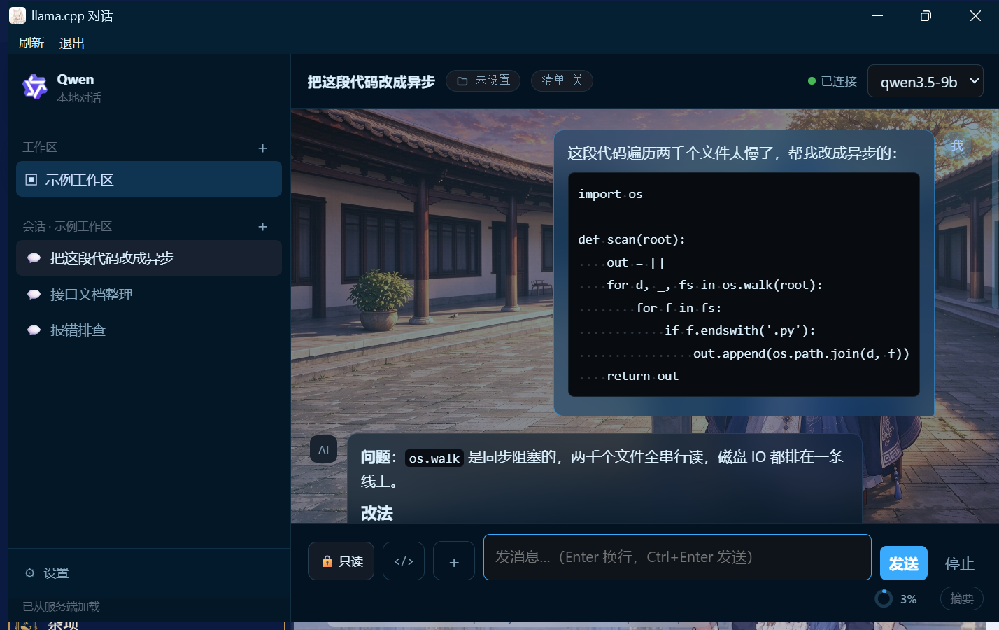
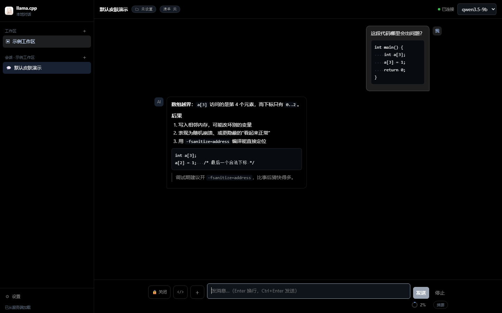
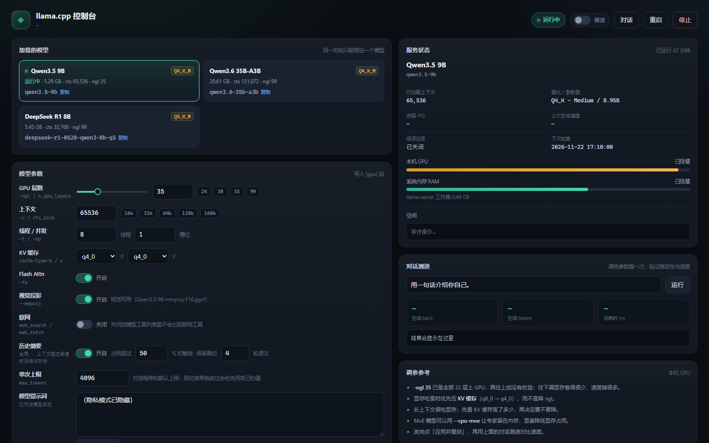
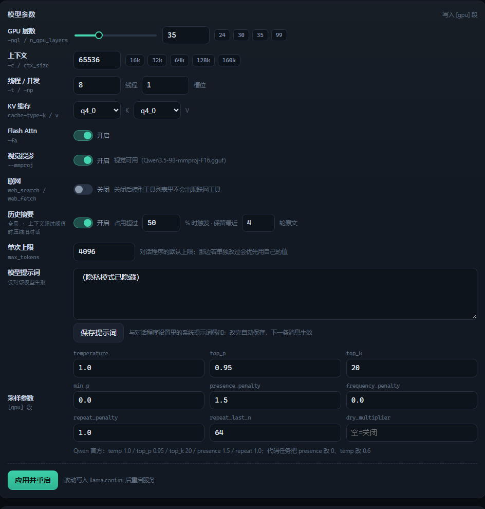
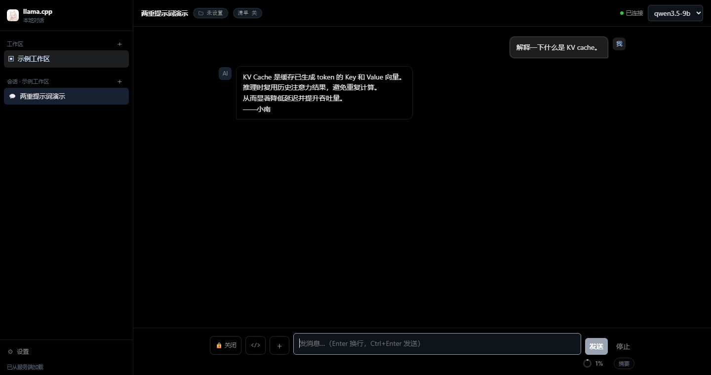

# llama.cpp 本地对话 + 控制台

Windows 上的本地大模型**一体化客户端**：原生窗口（WinForms + WebView2）里跑对话界面，
内置一个控制台面板管理模型和参数。不是浏览器标签页，不依赖任何云服务。

> 面向小显存单卡做过调优：模型怎么摆、上下文开多大、参数怎么调，都在控制台里能改、能测、能存。



## 3 秒看懂

- **原生 Windows 窗口**（WinForms + WebView2），不是浏览器标签页
- **对话和控制台一体**：模型、参数、日志、保活都在同一个程序里，改完点一下就重启生效
- **工具调用带权限分级**：只读 / 可写 / 完全访问，写文件和执行命令逐次审批
- **完全离线**：推理跑在本机 `llama-server` 上，断网也能用

默认皮肤（纯黑，无背景图）：



控制台（调模型、看参数、跑测速）：



调参区是这个项目花最多心思的地方——**每个模型一套独立参数**，改完点「应用并重启」即刻生效：



能调的东西：

- **显存**：GPU 层数（ngl）、KV 缓存量化（K/V 分开设）、Flash Attn
- **长度**：上下文大小、单次回答上限、并发槽位
- **性能**：线程数、并行槽位
- **能力**：视觉投影（图片输入）、联网工具开关、历史摘要阈值
- **提示词**：每个模型独立的模型提示词，与对话程序里的系统提示词叠加
- **采样**：temperature / top_p / top_k / min_p / presence / frequency / repeat / dry

每个模型（`[gpu]` / `[qwen36]` / `[deepseek]`）各存一份，切换模型不用重新调。

## 功能

**对话**
- 原生窗口，左侧工作区 / 会话管理（新建、改名、删除、右键改名）
- Markdown 渲染：粗体、斜体、删除线、标题、列表、引用、代码块（代码块显示空格点、等宽对齐）
- 图片输入（需 mmproj 视觉投影）、文本/代码附件（自动按扩展名加语言标记）
- 上下文占用环（按会话独立记账）、令牌用量与 tok/s
- 旧历史自动摘要：上下文超过阈值时把早期对话压成要点（可手动触发）

**工具调用**（按权限分级）
- 只读 / 工作区可写 / 完全访问 三级，按会话独立设置
- 写文件、执行命令每次弹审批框，可勾选「本会话内同类操作不再询问」
- 路径限制在工作区内；`shell` 仅完全访问档可用

**联网**
- `web_search`：Bing RSS 主引擎 + 360 兜底，多页抓取 → 逐条相关性打分 → 只把有用的交给模型
- `web_fetch`：容器打分提取正文（不是把整页标签扒掉），过滤导航与页脚
- SSRF 防护：只允许 http/https，解析后逐个 IP 拦内网 / 回环 / 链路本地地址，重定向逐跳校验

**控制台**（`panel/`，127.0.0.1:8090）
- 模型卡片、GPU 层数 / 上下文 / 线程 / KV 缓存 / flash-attn / 视觉投影 / 联网开关
- 每个模型独立的采样参数、`max_tokens`、模型提示词
- 服务状态、显存与内存条、操作日志、对话测速、保活开关
- 改参数前自动备份 `llama.conf.ini`，并可一键重启服务

**工程细节**
- 保活用计划任务 + GUI 子系统启动器，**全程没有控制台窗口闪现**
- 面板进程看门狗：面板挂了自动拉起
- 会话文件原子写入 + 每次保存前留快照（保留 30 份）

## 目录结构

```
llama-local/
├── chat-app/            原生外壳（C# WinForms + WebView2）
│   ├── src/Program.cs
│   ├── app.manifest
│   ├── assets/app.ico
│   └── build.ps1        编译脚本
├── panel/               控制台（Python 标准库，无第三方依赖）
│   ├── app.py           HTTP 服务 + 配置读写 + 工具执行器
│   ├── tools.py         文件/联网工具与安全护栏
│   ├── ui.html          控制台界面
│   └── start.cmd        双击启动
├── web/                 对话前端（静态页）
│   ├── chat.html
│   └── skins/           皮肤清单 + 图标（背景图需自备）
├── scripts/
│   ├── start-llama.ps1        启动 / 切换 / 停止 / 保活检查
│   ├── register-keepalive.ps1 注册计划任务
│   ├── windowless-runner.cs   无窗口启动器源码
│   ├── llama.conf.example.ini 配置示例
│   └── models.ini             llama-server 的 router 预设（可选）
├── docs/                架构与配置说明
├── bin/                 llama.cpp 二进制（自行下载，见 bin/README.md）
└── models/              GGUF 模型（自行放置，见 models/README.md）
```

## 快速开始

### 一条命令

```powershell
powershell -ExecutionPolicy Bypass -File setup.ps1
```

它会依次完成：检查环境（PowerShell / C# 编译器 / WebView2 / 显卡）→ 下载 llama.cpp 二进制
（GitHub 失败自动换镜像）→ 下载 WebView2 托管库 → 编译 `llama-chat.exe` → 生成 `llama.conf.ini` → 自检。

常用参数：

```powershell
# 指定模型和显存（决定默认 ngl / 上下文大小）
setup.ps1 -Model D:\models\qwen3-8b-q4.gguf -VramGb 8

# 没有 N 卡，用 Vulkan 后端（只下 37 MB，不需要 CUDA）
setup.ps1 -Backend vulkan

# 只是看看它会做什么
setup.ps1 -DryRun
```

装完放好模型，然后：

```powershell
powershell -ExecutionPolicy Bypass -File scripts\start-llama.ps1
.\chat-app\llama-chat.exe
```

### 手动步骤（想自己控制每个环节时）

1. **llama.cpp 二进制**：按 `bin/README.md` 下载解压到 `bin/cuda/`
2. **模型**：GGUF 放进 `models/`
3. **配置**：`copy scripts\llama.conf.example.ini scripts\llama.conf.ini`，改模型路径与 `[tools] workspace`
4. **编译外壳**：`powershell -ExecutionPolicy Bypass -File chat-app\build.ps1`
5. **启动**：见上面两条命令

### 常驻保活（可选）

```powershell
powershell -ExecutionPolicy Bypass -File scripts\register-keepalive.ps1
```

注册一个每 3 分钟检查一次的计划任务，服务挂了自动拉起，且**不会闪控制台窗口**。

## 快捷键

| 按键 | 行为 |
|---|---|
| `Enter` | 换行 |
| `Ctrl+Enter` | 发送 |
| `Ctrl+Shift+C` | 把选中文字包成代码块 |
| `Tab` | 插入 4 个空格 |
| `Esc` | 关闭弹窗 / 图片灯箱 |

输入框里输入 `{` `[` `(` 会自动补配对，在两括号中间按 `Enter` 展开并缩进（类似 VS Code）。

## 两重系统提示词

提示词分两层叠加，顺序是：**模型提示词（控制台按模型配）→ 用户系统提示词（设置里配）**。

- **模型提示词**：控制台「模型参数 → 模型提示词」，只对该模型生效，换模型自动换
- **用户系统提示词**：对话程序「设置 → 系统提示词」，对你所有模型都生效

效果示例（模型提示词定义了身份和收尾格式，用户系统提示词规定了输出顺序）：

> 模型提示词：你是「小南」，一位说话很简短的技术助教。每条回答不超过 4 行，最后单独一行写「——小南」。
> 用户系统提示词：回答用中文；先给结论，再给原因。



## 皮肤与强调色

默认**按模型家族自动切换**（DeepSeek 深蓝 / Qwen 天蓝 / 其他纯黑），也可以在
对话程序「设置 → 皮肤」里手动指定，并用取色器自定义强调色（按钮、链接、选中项、上下文环跟着变）。

- 手选皮肤或颜色后，设置随会话文件持久化
- 点「跟随皮肤」清掉自定义色，回到皮肤自带配色
- 不想要背景图？删掉 `web/skins/*/bg.jpg` 即可，自动回落到纯色

## 会话与模型绑定

- 每个会话记住自己用过的模型；切换会话时下拉框跟着回到那个模型
- **在同一会话里换成别的模型会弹确认框**：混用模型会让回答风格和上下文理解不连续
- 如果服务端已经换成别的模型（比如在控制台切了模型重启），标题栏会显示
  「≠ 原用 xxx」的提示，提醒你这个会话原本用的是哪个

## 控制台隐私模式

截图分享时给控制台地址加上 `?privacy=1`：

```
http://127.0.0.1:8090/?privacy=1
```

会隐藏本机路径、显卡型号、显存/内存数值、进程号和模型提示词——本文档的控制台截图就是这么拍的。

## 设计要点

- **一个 llama-server，多个客户端**：控制台和对话页都通过 HTTP 访问 8080，模型只加载一份
- **配置即真相**：`llama.conf.ini` 是唯一配置源，控制台写它，启动脚本读它
- **参数按模型独立**：每个模型有自己的段（`[gpu]` / `[qwen36]` / `[deepseek]`），采样、上下文、KV 类型互不影响
- **安全默认**：面板与 llama-server 只监听 `127.0.0.1`；工具按会话授权；联网工具可整体关闭

更多细节见 [`docs/ARCHITECTURE.md`](docs/ARCHITECTURE.md) 与 [`docs/CONFIG.md`](docs/CONFIG.md)。

## 关于本仓库的内容

仓库里**只有源代码与文档**：不含模型权重、llama.cpp 二进制、聊天记录、截图，也不含任何本机路径或个人信息。
配置用的是 `scripts\llama.conf.example.ini` 模板，路径与模型名都是占位值，按你的环境改。

## 已知限制

- 仅 Windows（WinForms + WebView2 + 计划任务）
- 参数面板是针对单卡 8 GB 调的，多卡 / 大显存机器也能用，但默认值需要自己重调
- 表格 Markdown 暂不渲染（模型画的表经常列数不齐）
- 联网搜索依赖 Bing / 360 的公开页面，会间歇性返回无关结果——已做相关性校验与换词重试

## 皮肤素材与版权

内置三套皮肤（默认纯黑 / DeepSeek 深蓝 / Qwen 天蓝），可在「设置 → 皮肤」里手动切换，
默认按模型家族自动匹配。

| 素材 | 来源 |
|---|---|
| `web/skins/qwen/bg.jpg` | 本项目作者用 AI 生成 |
| `web/skins/deepseek/bg.jpg`、`bg.webp` | 收集自网络，仅作界面演示 |

> **如有侵权，请联系作者，会立即删除。**

不想要图片的话直接删掉文件即可，皮肤会自动回落到纯色主题。

## License

[MIT](LICENSE)
